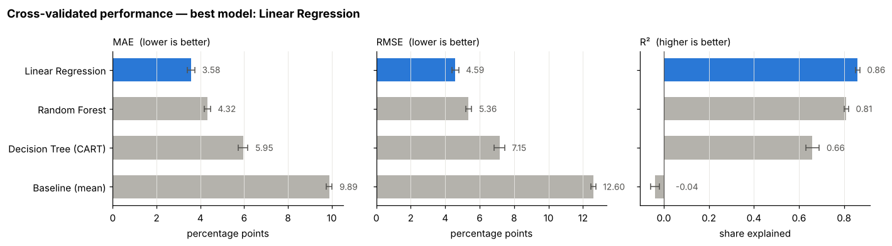
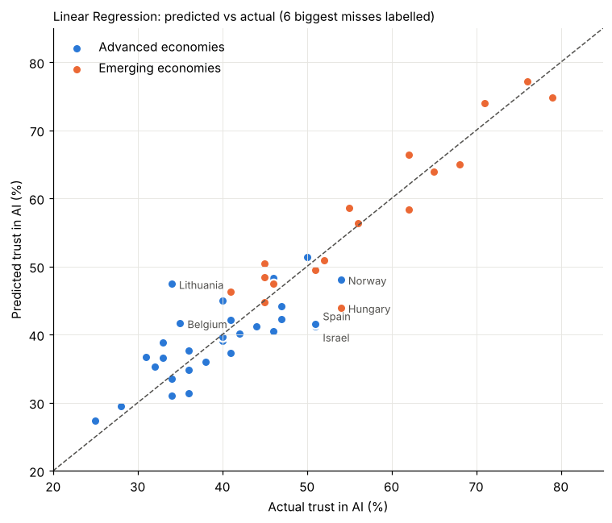
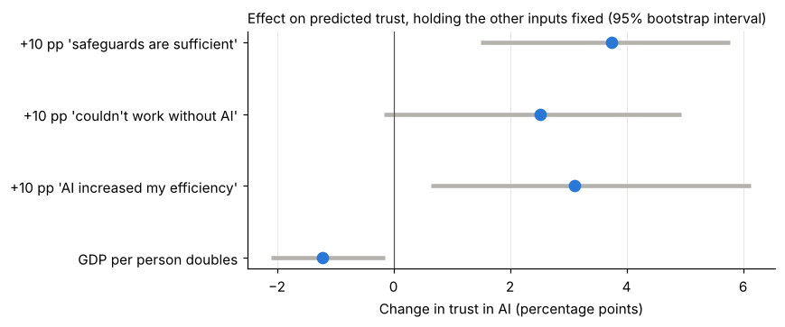

# Predictive Model for Country-Level AI Trust Scores

**TL;DR:** Using just four survey and economic inputs, a cross-validated Linear Regression predicts a country's AI trust score to within **3.6 percentage points** on average and explains **86%** of the differences between 47 countries. Perceived AI safeguards are the strongest driver.

**Tools:** Python · pandas · scikit-learn · matplotlib

## Business question

What share of a country's population trusts AI, and which factors explain the differences? A model that answers this helps governments and companies see where trust is likely to be low and what might raise it.

## Dataset

A country-level AI survey dataset provided for the Machine Learning course: **47 countries × 43 columns**, with no missing values. The columns are survey percentages on AI trust, AI use at work, perceived safeguards, benefits and training, plus GDP per capita.

- **Target:** `trust_ai_pct`, the percentage of people in a country who trust AI.
- **Inputs (4):** `safeguards_sufficient_pct`, `increased_efficiency_pct`, `couldnt_work_without_ai_pct`, and log GDP per capita.
- **Left out on purpose:** columns that are just other measures of trust (for example `accept_ai_pct`, `risks_outweigh_benefits_pct`), because using them would leak the answer into the inputs.

The data file is not included in this repository. To rerun the notebook, place it at `archive/ai_trust_by_country.csv`.

## Approach

1. **Choose the inputs:** 4 predictors from a feature-selection step, each standing for a group of overlapping survey questions.
2. **Choose the models:** a mean baseline, Linear Regression, a Decision Tree (CART) and a Random Forest.
3. **Test them fairly:** with only 47 countries, a single train/test split is unreliable. The same model's R² ranges from about 0.5 to 0.96 across 50 random 70/30 splits. So the models are compared with **repeated 5-fold cross-validation**, with hyperparameters tuned inside each fold.
4. **Explain the winner:** bootstrap confidence intervals for each effect, permutation importance, and a review of the countries the model gets wrong.

## Model evaluation

| Model | MAE (pp) | RMSE (pp) | R² |
|---|---:|---:|---:|
| Baseline (mean) | 9.89 | 12.60 | −0.04 |
| **Linear Regression** | **3.58** | **4.59** | **0.86** |
| Decision Tree (CART) | 5.95 | 7.15 | 0.66 |
| Random Forest | 4.32 | 5.36 | 0.81 |

**Linear Regression wins on every metric.** With only about 38 training countries per fold, the flexible models have too little data to learn more than a straight line, so their extra flexibility mostly fits noise.

About 3 in 4 countries are predicted within ±5 percentage points, and the errors are balanced between advanced and emerging economies.

## Key results: what drives trust

- **+10 pp of people saying AI safeguards are sufficient → about +3.8 pp trust.** This is the clearest effect.
- **+10 pp of people saying AI increased their efficiency → about +3.1 pp trust.**
- **Doubling GDP per person → about −1.2 pp trust.** Richer countries are slightly *less* trusting.
- **Biggest misses:** Lithuania trusts AI much less than predicted. Hungary, Israel and Spain trust it more than predicted.

**Robustness:** the 4 selected inputs beat the original 5-input suggestion (R² 0.86 vs 0.77). Feeding plain Linear Regression all 34 inputs drops R² to −0.48, a clear case of overfitting that shows why feature selection was needed.

## Recommendation

- **To raise trust in AI, make safeguards visible.** Perceived safeguards have the largest and most reliable effect, so clear rules, audits and public communication about AI oversight are the strongest lever.
- **Show people concrete efficiency gains.** Countries where workers feel AI made them more efficient trust it more.
- **Look beyond the survey for the outliers.** Countries such as Lithuania, Hungary and Israel are poorly explained by these inputs, so local politics or recent AI events are worth investigating there.

## Limitations

- The inputs were selected using all 47 countries. A stricter check, with selection inside each fold, gives R² ≈ 0.73.
- The sample is small and unbalanced, with few countries from Africa, Oceania and North America.
- The results show associations, not causes, and describe country averages rather than individuals.
- The data is a single survey snapshot, so it says nothing about how trust changes over time.

## How to run

Open `predicting_ai_trust.ipynb` in Jupyter or VS Code. The results and charts are saved in the notebook, so you can read it without running it.

## About this project

This was a group project for the Machine Learning course in the MSc Business Analytics programme at Nanyang Technological University. I worked on the predictive modelling question: predicting AI trust.
